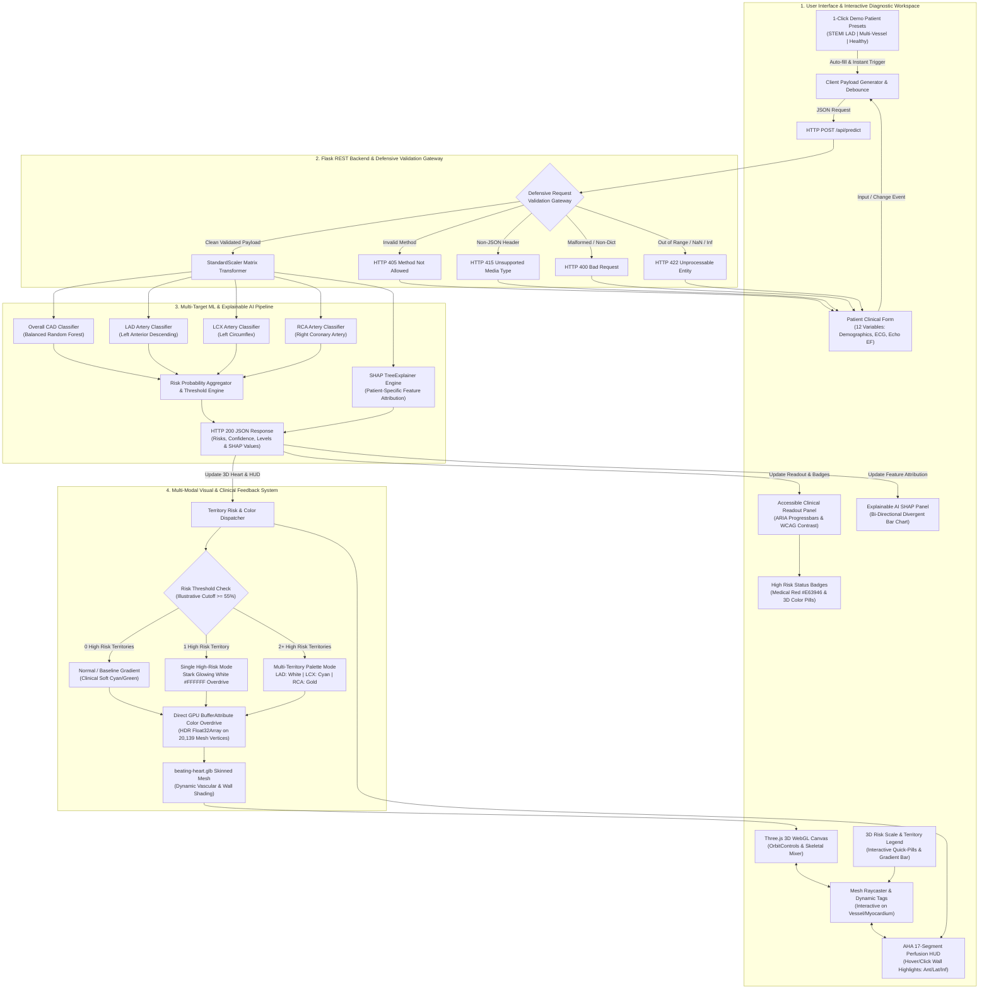

# Cardiac Risk Prediction Using ML & 3D Visualization - System Architecture Flow

This document outlines the end-to-end architecture and data flow of the **Cardiac Risk Prediction** platform, from patient clinical parameter collection and defensive API validation to 4-target machine learning inference, SHAP explainable AI, and multi-modal visual feedback (3D GPU vertex color overdrive, AHA myocardial wall perfusion HUD, 3D color scale legend, and accessible medical red UI indicators).

---

## Architecture Flow Diagram

---

## Component Breakdown

### 1. User Interface & Interactive Diagnostic Workspace
- **1-Click Demo Patient Presets**: Allows judges and clinicians to test instant end-to-end color transitions with one click:
  - *High-Risk Anterior STEMI (LAD):* Triggers single-territory Stark White (`#FFFFFF`) overdrive on the anterior wall & apex.
  - *Multi-Vessel CAD:* Triggers multi-color palette (LAD: White, LCX: Cyan, RCA: Gold) and bold medical red readout cards.
  - *Healthy Baseline:* Displays soft normal baseline cyan/teal gradient.
- **Clinical Parameter Form**: Captures 12 patient variables (demographics, symptoms, ECG findings, and echocardiography metrics) with synchronized input/change listeners and auto-sync debouncing.
- **Interactive 3D Stage**: WebGL-powered 3D stage featuring a realistic beating heart model (`beating-heart.glb`) with orbit controls, zoom presets, and continuous skeletal animations.
- **AHA 17-Segment Perfusion HUD Overlay**: Floating dark glassmorphic tooltip on the 3D canvas displaying real-time myocardial supply zones on hover/click:
  - *LAD:* Anterior & Anteroseptal walls, Apex (AHA 1, 2, 7, 8, 13, 14, 17)
  - *LCX:* Lateral & Posterior left ventricular walls (AHA 5, 6, 11, 12, 16)
  - *RCA:* Inferior wall, Right Ventricle, Inferoseptal segments (AHA 3, 4, 9, 10, 15)
- **3D Color Scale & Territory Legend Overlay**: Compact canvas overlay displaying the risk gradient (0% $\rightarrow$ $\ge 55\%$) and quick-selection territory pills.
- **Explainable AI (SHAP) Panel**: Visualizes patient-specific bi-directional divergent bar charts (Red for risk-raising factors, Blue for risk-lowering factors) paired with actual clinical values (e.g., `BP 138 mmHg`).
- **Accessible Clinical Readout Panel**: Displays numerical stenosis percentages, WCAG 4.5:1 compliant contrast cards, accessible ARIA progressbars (`role="progressbar"`, `aria-valuenow`, `aria-live="polite"`), and bold medical red (`#E63946`) high-risk status alert bars.

### 2. Backend Engine & Defensive Gateway (Flask API)
- **Defensive Multi-Tier Validation**:
  - `405 Method Not Allowed`: Graceful JSON error if non-POST methods are routed to `/api/predict`.
  - `415 Unsupported Media Type`: Guard if client sends raw text or non-`application/json` payload.
  - `400 Bad Request`: Rejection if JSON body is not an object/dictionary.
  - `422 Unprocessable Entity`: Strict numeric boundary checks and `math.isfinite()` validation blocking `NaN` and `Infinity`.
- **Precomputed Scaler**: Applies `StandardScaler` transformation on 12 features before inference.

### 3. Machine Learning Inference & Explainability Pipeline
- **Ensemble Random Forest Classifiers**: 4 trained models predict independent probabilities:
  1. Overall Coronary Artery Disease (`CAD`)
  2. Left Anterior Descending (`LAD`) stenosis
  3. Left Circumflex (`LCX`) stenosis
  4. Right Coronary Artery (`RCA`) stenosis
- **SHAP TreeExplainer Engine**: Computes patient-specific SHAP values across all 4 targets simultaneously on scaled input features, explaining which factors increased or decreased the patient's predicted risk.
- **Risk Aggregator**: Evaluates severe stenosis cutoffs (threshold $\ge 55\%$), dispatches confidence alerts, and bundles SHAP explanation dictionaries into the HTTP 200 response.

### 4. Multi-Modal Visual Diagnostic Feedback System
- **Real-Time GPU Vertex Shading**: Overdrives Float32 vertex colors directly into `THREE.BufferAttribute` across 20,139 tagged vertices:
  - **Single stenosed territory**: Stark Glowing White (`#FFFFFF`, HDR overdrive multiplier `6.5`).
  - **Multiple stenosed territories**: Distinct contrasting color coding:
    - **LAD**: Stark White (`#FFFFFF`)
    - **LCX**: Electric Cyan (`#00E5FF`)
    - **RCA**: Vivid Amber/Gold (`#FFB800`)
  - **Hover/Click Myocardial Wall Illumination**: Illuminates the exact supplied myocardial walls corresponding to the inspected artery.
  - **Normal / Low Risk**: Clinical soft baseline gradient (`#1DD1A1` to `#00E5FF`).
- **UI Readout Synchronization**: High predicted risk territories are flagged with bold Medical Red (`#E63946`) status bars alongside 3D color pill tags for instant cross-referencing.
